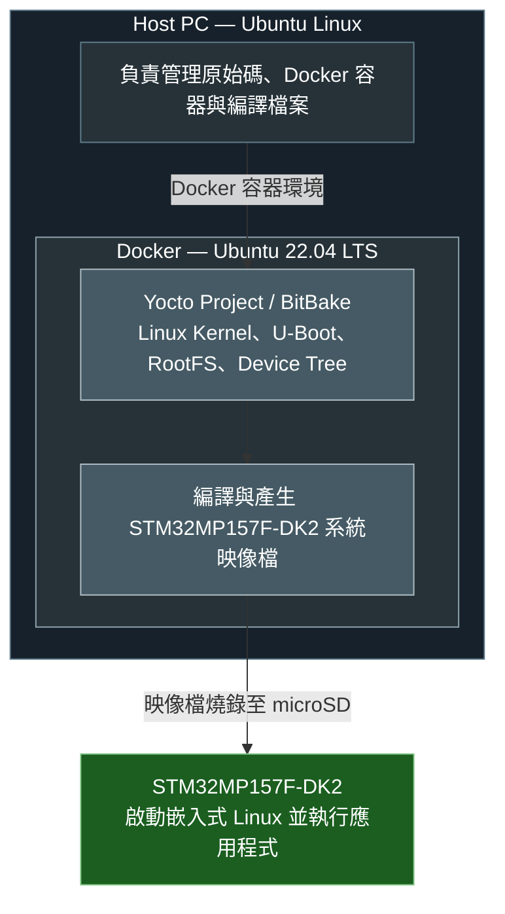

# STM32MP157F-DK2 開發

介紹如何使用這塊開發板，開發皆以 Ubuntu 22 為主，若是使用 Windows 的話需要先裝虛擬機或是 Docker 這點自行評估。</br>
所有開發相關都放在 [Workspace](/Workspace/) 中，這邊先做基本介紹與環境使用。

</br>

### 簡介

STM32MP157F-DK2 是由 STMicroelectronics（意法半導體）推出的嵌入式開發平台，採用 STM32MP157F 微處理器，整合雙核心 Arm Cortex-A7（800 MHz）與 Arm Cortex-M4，具備 Linux 作業系統執行能力及即時控制功能，適合應用於嵌入式系統、工業控制、人機介面（HMI）及物聯網（IoT）等領域。

開發板搭載 4 吋 480 × 800 解析度的 MIPI DSI 觸控顯示器，並提供 Wi-Fi、Bluetooth、Gigabit Ethernet、USB、HDMI、音訊及 GPIO 等周邊介面，可用於開發圖形化操作介面、網路通訊及感測器整合等應用。

本開發筆記以 STM32MP157F-DK2 為核心，採用 Yocto Project 建立客製化嵌入式 Linux 系統，記錄從開發環境建置、Linux 映像檔編譯、系統啟動、硬體驅動設定，到圖形化介面與 Wi-Fi 通訊功能開發的完整流程，並逐步實作具備互動式介面的嵌入式智慧助理系統。

</br>

### 目錄

[1. 開發環境建置](#開發環境建置) </br>
[2. Yocto 系統建置](#yocto-系統建置) </br>
[3. 系統燒錄與啟動](#系統燒錄與啟動) </br>
[4. 其餘項功能](#其餘項功能)

</br>

## 開發環境建置

本章介紹 STM32MP157F-DK2 的嵌入式 Linux 開發環境，包含 Ubuntu 作業系統、Docker 容器化環境、STM32CubeProgrammer 燒錄工具，以及 STMicroelectronics 官方提供的 OpenSTLinux 系統映像檔。

開發過程採用 Ubuntu 22.04 LTS + Docker + Yocto Project，透過 Docker 建立獨立且可重複使用的 Linux 編譯環境，避免開發工具與套件版本影響主機系統。

</br>

本專案的開發環境分為三個部分：



</br>

#### Docker 安裝

以下操作在 Ubuntu 主機的 Terminal 中執行。

Step 1. 更新套件並安裝必要工具

```bash
sudo apt update
sudo apt install -y ca-certificates curl
```

</br>

Step 2. 加入 Docker 官方 GPG 金鑰

```bash
sudo install -m 0755 -d /etc/apt/keyrings

sudo curl -fsSL https://download.docker.com/linux/ubuntu/gpg \
  -o /etc/apt/keyrings/docker.asc

sudo chmod a+r /etc/apt/keyrings/docker.asc
```

</br>

Step 3. 加入 Docker 官方套件來源

```bash
sudo tee /etc/apt/sources.list.d/docker.sources > /dev/null <<EOF
Types: deb
URIs: https://download.docker.com/linux/ubuntu
Suites: $(. /etc/os-release && echo "${UBUNTU_CODENAME:-$VERSION_CODENAME}")
Components: stable
Architectures: $(dpkg --print-architecture)
Signed-By: /etc/apt/keyrings/docker.asc
EOF

sudo apt update
```

</br>

Step 4. 安裝 Docker Engine

```bash
sudo tee /etc/apt/sources.list.d/docker.sources > /dev/null <<EOF
Types: deb
URIs: https://download.docker.com/linux/ubuntu
Suites: $(. /etc/os-release && echo "${UBUNTU_CODENAME:-$VERSION_CODENAME}")
Components: stable
Architectures: $(dpkg --print-architecture)
Signed-By: /etc/apt/keyrings/docker.asc
EOF

sudo apt update
```

</br>

</br>

## Yocto 系統建置


</br>

## 系統燒錄與啟動


</br>

## 其餘項功能


</br>

## 參考資料

[Discovery kit with STM32MP157F MPU](https://www.st.com/en/evaluation-tools/stm32mp157f-dk2.html#overview)

[STM32MP157x-DK2 Get Start](https://wiki.st.com/stm32mpu/wiki/Getting_started/STM32MP1_boards/STM32MP157x-DK2)

[Yocto Project Documentation](https://docs.yoctoproject.org/5.0.12/)

[Yocto Project System Requirements](https://docs.yoctoproject.org/scarthgap/ref-manual/system-requirements.html)