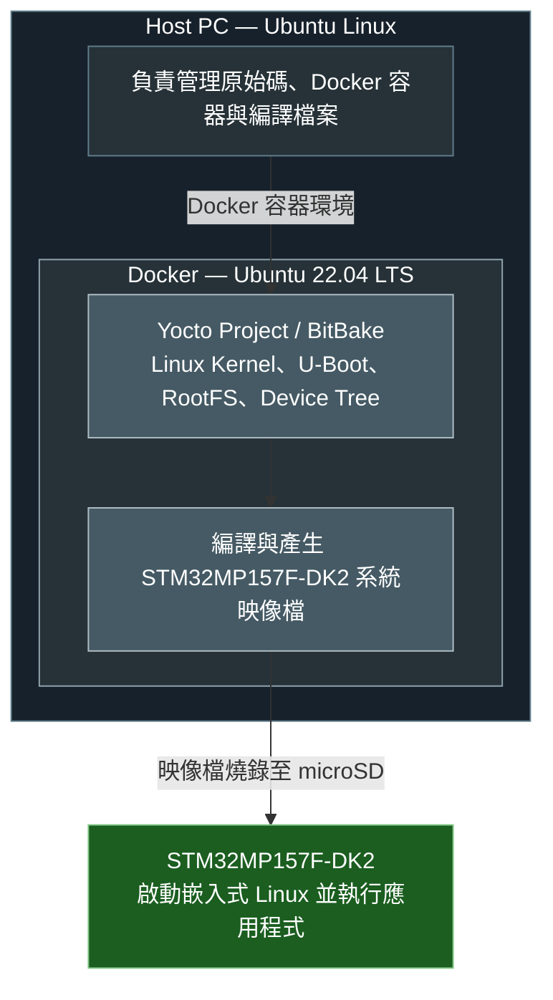

# STM32MP157F-DK2 開發

介紹如何使用這塊開發板，開發皆以 Ubuntu 22 為主，若是使用 Windows 的話需要先裝虛擬機或是 Docker 這點自行評估。</br>
所有開發相關都放在 [Workspace](/Workspace/) 中，這邊先做基本介紹與環境使用。

</br>

### 簡介

STM32MP157F-DK2 是由 STMicroelectronics（意法半導體）推出的嵌入式開發平台，採用 STM32MP157F 微處理器，整合雙核心 Arm Cortex-A7（800 MHz）與 Arm Cortex-M4，具備 Linux 作業系統執行能力及即時控制功能，適合應用於嵌入式系統、工業控制、人機介面（HMI）及物聯網（IoT）等領域。

開發板搭載 4 吋 480 × 800 解析度的 MIPI DSI 觸控顯示器，並提供 Wi-Fi、Bluetooth、Gigabit Ethernet、USB、HDMI、音訊及 GPIO 等周邊介面，可用於開發圖形化操作介面、網路通訊及感測器整合等應用。

本開發筆記以 STM32MP157F-DK2 為核心，採用 Yocto Project 建立客製化嵌入式 Linux 系統，記錄從開發環境建置、Linux 映像檔編譯、系統啟動、硬體驅動設定，到圖形化介面與 Wi-Fi 通訊功能開發的完整流程，並逐步實作具備互動式介面的嵌入式智慧助理系統。

</br>

### 目錄

[1. 開發環境建置](#開發環境建置) </br>
[2. Yocto 系統建置](#yocto-系統建置) </br>
[3. 系統燒錄與啟動](#系統燒錄與啟動) </br>
[4. 其餘項功能](#其餘項功能)

</br>

## 開發環境建置

本章介紹 STM32MP157F-DK2 的嵌入式 Linux 開發環境，包含 Ubuntu 作業系統、Docker 容器化環境、STM32CubeProgrammer 燒錄工具，以及 STMicroelectronics 官方提供的 OpenSTLinux 系統映像檔。

開發過程採用 Ubuntu 22.04 LTS + Docker + Yocto Project，透過 Docker 建立獨立且可重複使用的 Linux 編譯環境，避免開發工具與套件版本影響主機系統。

</br>

本專案的開發環境分為三個部分：



</br>

#### Docker 安裝

以下操作在 Ubuntu 主機的 Terminal 中執行。

Step 1. 更新套件並安裝必要工具

```bash
sudo apt update
sudo apt install -y ca-certificates curl
```

</br>

Step 2. 加入 Docker 官方 GPG 金鑰

```bash
sudo install -m 0755 -d /etc/apt/keyrings

sudo curl -fsSL https://download.docker.com/linux/ubuntu/gpg \
  -o /etc/apt/keyrings/docker.asc

sudo chmod a+r /etc/apt/keyrings/docker.asc
```

</br>

Step 3. 加入 Docker 官方套件來源

```bash
sudo tee /etc/apt/sources.list.d/docker.sources > /dev/null <<EOF
Types: deb
URIs: https://download.docker.com/linux/ubuntu
Suites: $(. /etc/os-release && echo "${UBUNTU_CODENAME:-$VERSION_CODENAME}")
Components: stable
Architectures: $(dpkg --print-architecture)
Signed-By: /etc/apt/keyrings/docker.asc
EOF

sudo apt update
```

</br>

Step 4. 安裝 Docker Engine

```bash
sudo tee /etc/apt/sources.list.d/docker.sources > /dev/null <<EOF
Types: deb
URIs: https://download.docker.com/linux/ubuntu
Suites: $(. /etc/os-release && echo "${UBUNTU_CODENAME:-$VERSION_CODENAME}")
Components: stable
Architectures: $(dpkg --print-architecture)
Signed-By: /etc/apt/keyrings/docker.asc
EOF

sudo apt update
```

</br>

以上事先安裝 Docker 接下來可以使用 Dockerfile 來建立我們需要的容器。

```bash
FROM ubuntu:22.04

# Build host for STM32MP1 OpenSTLinux (linux/amd64).
RUN apt-get update && DEBIAN_FRONTEND=noninteractive apt-get install -y --no-install-recommends \
    bc bison bsdmainutils build-essential bzip2 ca-certificates chrpath cpio curl \
    debianutils diffstat file flex gawk gcc-multilib git git-lfs iputils-ping \
    libegl1-mesa libgmp-dev libmpc-dev libncurses-dev libsdl1.2-dev libssl-dev \
    libusb-1.0-0 libyaml-dev locales lz4 make patch pylint python-is-python3 \
    python3 python3-git python3-jinja2 python3-pexpect python3-pip python3-subunit \
    bash-completion less nano openssh-client procps sudo tmux vim iproute2 \
    repo rsync socat texinfo unzip wget xterm xz-utils zip zstd \
    && locale-gen en_US.UTF-8 \
    && rm -rf /var/lib/apt/lists/*

ENV LANG=en_US.UTF-8 LC_ALL=en_US.UTF-8
ARG USER_ID=1000
ARG GROUP_ID=1000

RUN test "$USER_ID" -gt 0 && test "$GROUP_ID" -gt 0 \
    && (getent group "$GROUP_ID" >/dev/null || groupadd --gid "$GROUP_ID" builder) \
    && useradd --create-home --uid "$USER_ID" --gid "$GROUP_ID" --groups sudo --shell /bin/bash builder \
    && echo "builder ALL=(ALL:ALL) NOPASSWD: ALL" > /etc/sudoers.d/builder \
    && chmod 0440 /etc/sudoers.d/builder \
    && visudo -cf /etc/sudoers \
    && install -d -o builder -g "$GROUP_ID" /work

USER builder
WORKDIR /work

RUN sudo -n true && test -w /work && git --version && command -v repo
CMD ["/bin/bash"]
```

</br>

Dockerfile 主要設定說明

| 設定項目                   | 功能說明                   |
| :---------------------- | :---------------------- |
| `FROM ubuntu:22.04`    | 使用 Ubuntu 22.04 作為基礎系統 |
| `RUN apt-get install`  | 安裝編譯工具與相依套件            |
| `git`、`repo`           | 下載與管理 Yocto 原始碼        |
| `python3`、`gcc`、`make` | 提供原始碼編譯環境              |
| `locale-gen`           | 設定 UTF-8 語系            |
| `USER_ID`、`GROUP_ID`   | 對應主機使用者權限              |
| `USER builder`         | 使用一般使用者進行 Yocto 編譯     |
| `WORKDIR /work`        | 設定容器工作目錄               |
| `CMD ["/bin/bash"]`    | 使用 Bash 作為容器預設執行程式     |

</br>

#### 建立工作目錄與啟動 Docker

Step 1. 建立工作目錄

```bash
mkdir -p ~/stm32mp1-dev
mkdir -p ~/stm32mp1-work

cd ~/stm32mp1-dev
```

</br>

Step 2. 建立 Docker Image

```bash
docker build \
  --build-arg USER_ID="$(id -u)" \
  --build-arg GROUP_ID="$(id -g)" \
  -t stm32mp1-yocto:22.04 .
```

</br>

Step 3. 建立 Docker Container

```bash
docker run -dit \
  --name stm32mp1-yocto \
  -v "$HOME/stm32mp1-work:/work" \
  -w /work \
  stm32mp1-yocto:22.04 \
  /bin/bash
```

</br>

Step 4. 進入容器

```bash
docker exec -it stm32mp1-yocto bash
```

</br>

Step 5. 容器管理

```bash
# 查看容器
docker ps -a

# 停止容器
docker stop stm32mp1-yocto

# 重新啟動
docker start stm32mp1-yocto

# 重新進入
docker exec -it stm32mp1-yocto bash
```

</br>

## Yocto 系統建置

介紹 Yocto Project 的基本概念、系統架構、主要開發工具，以及如何在先前建立的 Docker 環境中，編譯適用於 STM32MP157F-DK2 的嵌入式 Linux 系統。

本專案使用 Yocto Project 搭配 STMicroelectronics 提供的 OpenSTLinux BSP，建立可自行修改核心、驅動程式、系統套件及應用程式的 Linux 環境。

</br>

Yocto Project 是嵌入式 Linux 開發常用的開源專案，提供一套建立客製化 Linux 發行版本的工具與建置流程。

與一般使用 Ubuntu、Debian 等現成 Linux 發行版本不同，Yocto 允許開發者依照硬體平台及應用需求，自行選擇 Linux Kernel、Bootloader、系統套件與應用程式，產生適合特定嵌入式設備的系統映像檔。

- 系統客製化：依照需求選擇 Linux Kernel、系統服務及應用程式。
- 硬體支援：透過 BSP 整合 STM32MP157F-DK2 的硬體驅動與 Device Tree。
- 交叉編譯：在 x86-64 Linux 主機上編譯適用於 Arm Cortex-A7 的程式。
- 套件管理：利用 Recipe 管理應用程式、函式庫及相依套件。
- 系統整合：將自行開發的程式加入 Linux 映像檔，並設定開機自動啟動。

</br>

Yocto Project 並非單一編譯器或作業系統，而是由多項開發工具、建置系統及設定檔共同組成。

| 元件                | 功能說明                    |
| :----------------- | :----------------------- |
| Yocto Project     | 提供嵌入式 Linux 開發架構與相關工具   |
| Poky              | Yocto 官方參考建置環境與發行版本     |
| OpenEmbedded-Core | 提供 Linux 系統基本套件與編譯規則    |
| BitBake           | 解析編譯設定並執行各項編譯任務         |
| Recipe (`.bb`)    | 描述軟體來源、編譯方式及安裝程序        |
| Layer (`meta-*`)  | 集中管理特定硬體或功能的 Recipe 與設定 |
| BSP               | 提供特定硬體平台的支援設定與驅動        |
| image             | 定義最終系統應包含的套件與功能         |

其中 BitBake、Recipe 與 Layer 這三個元件共同決定系統要編譯哪些程式、如何編譯，以及如何將程式安裝至最終的 Linux 系統。

用更白話文的方式說明：

| Yocto 元件                          | 比喻說明                                               |
| --------------------------------- | -------------------------------------------------- |
| **BitBake**                       | 廚房裡的「總主廚自動機器人」：接到指令後會自動照食譜下指令、調度廚師、組裝整份套餐       |
| **Recipes (.bb 檔案)**              | 一道道菜的「食譜」：說明要去哪裡拿食材、怎麼煮、要放哪裡、要附上什麼醬料（安裝哪個路徑）    |
| **Layers**                        | 不同的菜單區域：中餐、日式、甜點，各自收錄自己的食譜集合（Layer = 模組化菜單）     |
| **images**                        | 一整份套餐：你最後要上桌的完整 Linux rootfs，是由多道「recipe」料理組合而成 |
| **SRC\_URI**                      | 食材來源：告訴你去哪裡買原料（Git、http、local 檔案）               |
| **do\_compile() / do\_install()** | 烹飪流程：像是切菜、炒鍋、擺盤，對應程式的編譯與安裝過程                    |
| **sstate-cache**                  | 冷凍庫：之前做好的料理可以直接拿出來加熱，不需要每次重煮（加速建構）              |

</br>

Recipe 是 Yocto 最基本的軟體建置單位，其副檔名為 .bb，用於定義單一軟體套件的來源、相依關係、編譯方法及安裝方式。

Layer 則是管理不同 Recipe 與系統設定的目錄。開發者可以建立自己的 Layer，將應用程式及系統修改與官方原始碼分離，方便後續維護及版本更新。

因此，Yocto 的運作方式可以簡單理解為：
Layer 管理 Recipe → BitBake 執行編譯 → Image 整合套件 → Linux 系統啟動。

</br>

#### Yocto 基本使用與系統建置

進入 Docker 容器：

```bash
docker start stm32mp1-yocto
docker exec -it stm32mp1-yocto bash
```

</br>

確認目前使用者及相關工具：

```bash
whoami
pwd

git --version
python3 --version
repo version
```

Yocto 編譯需要較大的硬碟空間及記憶體。依官方文件，開發主機至少需準備約 90 GB 可用空間及 8 GB RAM；實務上建議使用 16 GB 以上 RAM，並保留更多儲存空間供原始碼、編譯快取及映像檔使用。

</br>

至 Github clone 三項工具

[Poky](https://github.com/yoctoproject/poky/tree/scarthgap)

```bash
git clone -b scarthgap https://github.com/yoctoproject/poky.git
```

[meta-openembedded](https://github.com/openembedded/openembedded-core/tree/scarthgap)

```bash
git clone -b scarthgap https://github.com/openembedded/openembedded-core.git
```

[meta-st](https://github.com/STMicroelectronics/meta-st-stm32mp/tree/scarthgap)

```bash
git clone -b https://github.com/STMicroelectronics/meta-st-stm32mp.git
```

記得都要 clone 到對的分支。

</br>

在 clone 完成後，我們先要初始化 poky 的工具，先執行以下 cmd

```bash
source poky/oe-init-build-env build
```

執行完成後就是初始化 yocto 好了。要有這項初始化才能繼續往下使用 poky。

</br>

完成原始碼下載後，專案主要包含下列目錄：

```
專案/
├── .repo/
│   └── manifests/
├── layers/
│   ├── meta-st/
│   │   ├── meta-st-stm32mp/
│   │   ├── meta-st-openstlinux/
│   │   └── scripts/
│   │
│   ├── meta-openembedded/
│   ├── openembedded-core/
│   └── ...
│
└── build-.../             # 初始化後建立
    ├── conf/
    │   ├── local.conf
    │   └── bblayers.conf
```

上述為簡化後的主要目錄結構，實際內容依 ST 發行版本及啟用的 Layer 而有所不同。

| 目錄或檔案                | 主要用途                 |
| -------------------- | -------------------- |
| `.repo/`             | 管理 Manifest 與各原始碼版本  |
| `layers/`            | 存放 Yocto 的各個 Layer   |
| `meta-st/`           | STM32 專用 BSP 與系統設定   |
| `meta-openembedded/` | 額外開源軟體套件             |
| `openembedded-core/` | OpenEmbedded 核心建置資料  |
| `local.conf`         | 設定編譯平台、執行緒及系統功能      |
| `bblayers.conf`      | 指定 BitBake 使用的 Layer |

</br>

接下來，先將 openembedded 與 st 的工具加入 yocto 中，執行以下命令

```bash
bitbake-layers add-layer ../meta-openembedded/meta-oe
bitbake-layers add-layer ../meta-openembedded/meta-python
bitbake-layers add-layer ../meta-st-stm32mp
```

根據自己的實際路徑做修改。

</br>

接著要加入 st 所提供的 machine，進入 `build/conf/local.conf` ，找到 `MACHINE` 將其改成 `stm32mp1`。

以上就算是基本都調整好了。

接下來就可以先第一次完整編譯，第一次編譯會需要大量的時間與系統資源。

```bash
bitbake core-image-minimal
```

若是擔心電腦會卡可以使用以下語法將 bitbake 同時執行的資源數降低，或是增加 ubuntu 的 swap 也可以。

```bash
BB_NUMBER_THREADS = "4"
PARALLEL_MAKE = "-j 4"
```

| 參數                  | 功能說明                  |
| ------------------- | --------------------- |
| `BB_NUMBER_THREADS` | 限制 BitBake 同時執行的工作數量  |
| `PARALLEL_MAKE`     | 限制單一編譯任務使用的 Make 平行數量 |

</br>

在編譯完成後可以在 build 的資料夾中找到很多我們的編譯產物。

- 最終需要燒錄的所有檔案 `build/tmp/deploy/images/stm32mp1`
- 其餘程式的產物會在 `build/tmp/work/` 裡面，根據功能不同放置的最後位置也會不同。

</br>

## 系統燒錄與啟動

[STM32CubeProgrammer 官方下載](STM32CubeProgrammer) 提供 GUI 與 CLI 兩種操作方式，支援 USB DFU 等連線模式，並能依照 FlashLayout 設定檔建立分割區及寫入系統內容。

</br>

下載 Linux 安裝套件後，解壓縮並執行安裝程式：

```bash
unzip en.stm32cubeprog.zip

chmod +x SetupSTM32CubeProgrammer-*.linux
./SetupSTM32CubeProgrammer-*.linux
```

</br>

Linux 環境需要安裝 USB 通訊套件：

```bash
sudo apt install libusb-1.0-0
```

</br>

簡易燒錄操作如下：
1. 將 microSD 卡插入 STM32MP157F-DK2，並將背面兩個 Boot Switch 設為 OFF，以進入 USB 燒錄模式。
2. 透過開發板的 CN7 USB OTG 連接埠連接電腦，接上電源後按下 Reset。
3. 開啟 STM32CubeProgrammer，選擇 USB 連線並按下 Connect。
4. 載入對應 STM32MP157F-DK2 的 FlashLayout_sdcard_stm32mp157f-dk2-optee.tsv，設定正確的映像檔路徑，然後執行 Download。
5. 燒錄完成後，將 Boot Switch 設為 ON，重新啟動開發板，由 microSD 開機。

</br>

#### ST 官方預設系統映像檔

OpenSTLinux 是 STMicroelectronics 針對 STM32MP 系列微處理器提供的嵌入式 Linux 發行環境，基於 Yocto Project 與 OpenEmbedded 建置。

官方映像檔整合了開發板所需的開機程式、Linux Kernel、Device Tree、硬體驅動及 Root File System，可直接用來測試 STM32MP157F-DK2 的基本功能。

目前對應的 STM32MP1 官方版本為 OpenSTLinux 6.6 / Yocto Scarthgap，STM32 MPU Ecosystem v6.2.1

[官方預設映像檔下載](https://www.st.com/en/embedded-software/stm32mp1starter.html?utm_source=chatgpt.com)

</br>

#### 系統映像檔組成

| 系統元件         | 功能                 |
| :------------ | :------------------ |
| TF-A         | 執行初期硬體初始化與安全開機流程   |
| OP-TEE       | 提供可信任執行環境          |
| U-Boot       | 負責載入 Linux Kernel  |
| Linux Kernel | 管理系統資源與硬體驅動        |
| Device Tree  | 描述開發板硬體配置          |
| RootFS       | 提供 Linux 執行環境及應用程式 |
| Weston       | 提供 Wayland 圖形顯示環境  |


## 其餘項功能

#### 官方 UART 監控

```bash

sudo apt-get install minicom

ls /dev/ttyACM*                 # 這邊應該會看到自己的板子
                                # /dev/ttyACM0
minicom -D /dev/ttyACM0         # 連接板子 Serial port

```

</br>

#### Wi-Fi 功能

</br>

## 參考資料

[Discovery kit with STM32MP157F MPU](https://www.st.com/en/evaluation-tools/stm32mp157f-dk2.html#overview)

[STM32MP157x-DK2 Get Start](https://wiki.st.com/stm32mpu/wiki/Getting_started/STM32MP1_boards/STM32MP157x-DK2)

[Yocto Project Documentation](https://docs.yoctoproject.org/5.0.12/)

[Yocto Project System Requirements](https://docs.yoctoproject.org/scarthgap/ref-manual/system-requirements.html)